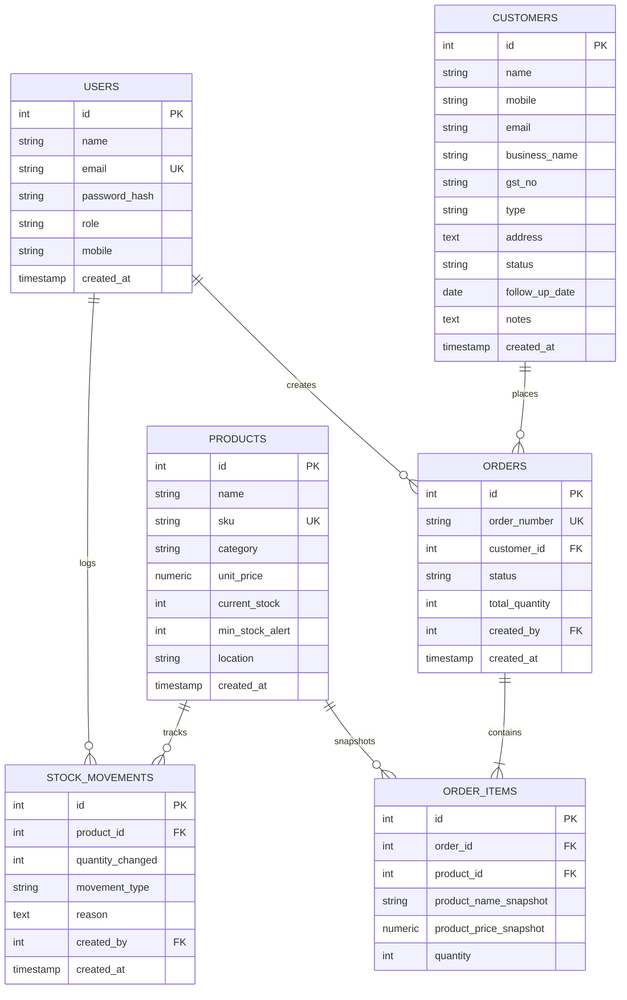

# 🏢 Mini ERP + CRM Operations Portal

A modern, full-stack ERP and CRM operations system designed for wholesale and distribution enterprises. Built with a robust **Node.js / Express / TypeScript** backend, a high-performance **React 19 / Vite** frontend featuring glassmorphism UI and interactive **Three.js** 3D background visualizers, and a resilient dual-mode database engine (**PostgreSQL 15** with automatic **in-memory pg-mem** fallback).


---

## 📋 Table of Contents

- [System Architecture](#-system-architecture)
- [Key Highlights & Differentiators](#-key-highlights--differentiators)
- [Tech Stack](#-tech-stack)
- [Directory & Project Structure](#-directory--project-structure)
- [Core Functional Modules](#-core-functional-modules)
- [Database Schema & ERD](#-database-schema--erd)
- [Environment Variables](#-environment-variables)
- [Getting Started & Local Setup](#-getting-started--local-setup)
- [Running via Docker](#-running-via-docker)
- [Serverless Deployment (Netlify)](#-serverless-deployment-netlify)
- [Complete API Reference](#-complete-api-reference)
- [Test Credentials & Roles](#-test-credentials--roles)
- [Documentation PDF Generator](#-documentation-pdf-generator)
- [Project Audit & File Hygiene](#-project-audit--file-hygiene)

---

## 🏗️ System Architecture

```
┌──────────────────────────────────────────────────────────────────┐
│                      Client Layer (Browser)                      │
│   React 19 + TypeScript (Vite) + Three.js 3D Visuals             │
│   Axios Client (JWT Bearer Auth) • Glassmorphism CSS System      │
└────────────────────────────────┬─────────────────────────────────┘
                                 │ HTTP / REST (Port 5173 / Port 80)
                                 ▼
┌──────────────────────────────────────────────────────────────────┐
│                     API Gateway / Backend Server                 │
│   Express.js (TypeScript) • Netlify Serverless Function Adapter │
│   • Middleware: JWT Auth, RBAC Role Checks, Zod Validation       │
│   • Controllers & Modular Services (Transactional Operations)   │
└────────────────────────────────┬─────────────────────────────────┘
                                 │ Raw SQL Queries (pg driver)
                                 ▼
┌──────────────────────────────────────────────────────────────────┐
│                         Database Layer                           │
│  Primary: PostgreSQL 15 (Docker / Supabase / Neon / Local)       │
│  Fallback: In-Memory Database (pg-mem) with Auto-Seeding        │
└──────────────────────────────────────────────────────────────────┘
```

### Architectural Principles
1. **Raw SQL with `pg` Driver**: Eliminates heavy ORM overhead, showcasing direct, high-performance relational SQL design, index-ready tables, and explicit transactions.
2. **ACID Transactional Stock Deduction**: Sales order confirmation and stock movements execute within `BEGIN ... COMMIT / ROLLBACK` transactions, strictly preventing negative stock and concurrency race conditions.
3. **Auditable Point-in-Time Product Snapshots**: Order line items store immutable snapshots of product name and unit price at the time of order creation, protecting order history against future catalog price changes.
4. **Dual Engine Database Resilience**: Automatically connects to PostgreSQL if available; if not reachable or when executed in serverless environments, seamlessly initializes a full in-memory PostgreSQL engine (`pg-mem`) and seeds sample records without breaking application startup.
5. **Feature-Modular Backend Organization**: Segregated into clean domains (`auth`, `customers`, `products`, `stock`, `orders`), each structured into `router → controller → service → schema`.

---

## 🛠️ Tech Stack

| Layer | Technology | Version | Purpose |
|---|---|---|---|
| **Backend Runtime** | Node.js + Express.js | 20+ / 4.21 | REST API application server |
| **Language** | TypeScript | 5.6+ | Type safety across backend & frontend |
| **Database** | PostgreSQL | 15+ | Relational data persistence with foreign keys |
| **Fallback DB** | `pg-mem` | 3.0+ | Zero-config in-memory PostgreSQL emulation |
| **Authentication** | JWT (`jsonwebtoken`) + `bcryptjs` | 9.0 / 2.4 | Stateless token auth & secure password hashing (cost factor 12) |
| **Validation** | Zod | 3.23+ | Strict request payload schema validation |
| **Serverless** | `serverless-http` | 3.2+ | Netlify Functions serverless handler |
| **Frontend Framework** | React + React DOM | 19.2+ | Component-driven user interface |
| **Bundler & Tooling** | Vite | 8.2+ | Fast HMR development and production bundling |
| **3D Engine** | Three.js | 0.185+ | Interactive 3D particle canvas background |
| **Styling** | Vanilla CSS Glassmorphism | Custom | 40+ reusable glassmorphism utility classes |
| **Routing** | React Router DOM | 7.18+ | Client-side routing with role-guarded views |
| **HTTP Client** | Axios | 1.19+ | API client with automatic token interceptors |
| **Containerization** | Docker & Docker Compose | 3.8 | Multi-container orchestration (DB, API, Web) |
| **Documentation** | Python + ReportLab | 5.0+ | Automated PDF technical guide generator |

---

## 📁 Directory & Project Structure

The project maintains a structured monorepo layout:

```
ERP - CRM portal/
├── .env.example                 # Unified master environment template
├── .env                         # Master environment configuration (local defaults)
├── .gitignore                   # Version control ignore list (logs, dist, node_modules, .env)
├── README.md                    # Complete project documentation & guide
├── build_pdf.py                 # Automated documentation generator (ReportLab PDF)
├── docker-compose.yml           # Multi-container Docker orchestration (Postgres, API, UI)
├── netlify.toml                 # Netlify deployment, function bundler, & SPA routing rules
├── package.json                 # Monorepo / Netlify build script & shared dependencies
├── postman_collection.json      # Postman API test collection (with auto-token capture)
│
├── backend/                     # Node.js + Express + TypeScript API Server
│   ├── .env.example             # Backend environment template
│   ├── .env                     # Local backend environment variables
│   ├── Dockerfile               # Production container definition for backend API
│   ├── package.json             # Backend dependencies and scripts
│   ├── tsconfig.json            # TypeScript configuration
│   └── src/
│       ├── server.ts            # Express server initialization, routing, & health checks
│       ├── config/
│       │   ├── db.ts            # PostgreSQL connection pool with pg-mem fallback
│       │   ├── env.ts           # Type-safe environment variable parser
│       │   └── seed.ts          # DDL table creation and initial dataset seeder
│       ├── middleware/
│       │   ├── auth.ts          # JWT bearer token verification
│       │   ├── roleCheck.ts     # Role-based access control (RBAC) guard
│       │   ├── validate.ts      # Zod schema validation middleware
│       │   └── errorHandler.ts  # Global centralized exception handler
│       ├── modules/
│       │   ├── auth/            # Login, current user profile, profile updates
│       │   ├── customers/       # CRM customer lifecycle, notes, & filtering
│       │   ├── products/        # Inventory catalog, SKU uniqueness, & stock tracking
│       │   ├── stock/           # Stock IN/OUT adjustment audits & movements
│       │   └── orders/          # Sales order lifecycle, transactional stock deduction
│       └── utils/
│           ├── jwt.ts           # Token generation and verification utilities
│           ├── orderNumber.ts   # Order number format generator (ORD-YYYYMMDD-XXXX)
│           └── response.ts      # Standardized JSON response envelope helpers
│
├── frontend/                    # React 19 + TypeScript + Vite Client Application
│   ├── .env.example             # Frontend environment template
│   ├── .env                     # Frontend local environment (API endpoint)
│   ├── .oxlintrc.json           # Linter rules configuration
│   ├── Dockerfile               # Multi-stage Docker build (Vite build -> Nginx server)
│   ├── nginx.conf               # Nginx reverse proxy & SPA fallback configuration
│   ├── index.html               # Web application entry HTML
│   ├── package.json             # Frontend dependencies and scripts
│   ├── vite.config.ts           # Vite build and plugin configurations
│   ├── public/
│   │   ├── _redirects           # Netlify SPA redirect rules
│   │   ├── favicon.svg          # Custom SVG application favicon
│   │   └── icons.svg            # UI icons sprite
│   └── src/
│       ├── main.tsx             # React DOM root render
│       ├── App.tsx              # Application route map and role boundaries
│       ├── index.css            # Custom glassmorphism design system
│       ├── api/                 # Modular Axios service connectors
│       ├── components/          # Reusable UI widgets (Sidebar, ThreeBackground, ProtectedRoute)
│       ├── context/             # AuthContext (user state, persistent tokens)
│       ├── pages/               # Functional views (Login, Dashboard, Customers, Products, Stock, Orders, Profile)
│       └── types/               # TypeScript interfaces and entity types
│
└── netlify/
    └── functions/
        └── api.ts               # Serverless HTTP wrapper for Express backend
```

---

## ✨ Core Functional Modules

### 1. 🔐 Authentication & RBAC Security
- **4 Distinct Roles**:
  - `Admin`: Unrestricted system access across all modules.
  - `Sales`: Customer management, sales order drafting, and order confirmation.
  - `Warehouse`: Product management, stock movements (IN/OUT), and inventory audit.
  - `Accounts`: Read-only access to customer ledgers, sales orders, and audit logs.
- Profile management with current password verification and password updates.

### 2. 👥 Customer Relationship Management (CRM)
- Search across customer name, business entity, email, and mobile number.
- Categorization by type (`Retail`, `Wholesale`, `Distributor`) and status (`Lead`, `Active`, `Inactive`).
- Interaction timeline with timestamped follow-up logs and next-action scheduling.

### 3. 📦 Inventory & Product Catalog
- Strict unique SKU validation with category clustering.
- Real-time stock tracking with configurable minimum threshold (`min_stock_alert`).
- Low-stock visual alert badges with dedicated filter views.

### 4. 🔄 Stock Movement & Audit Trail
- Log manual stock intake (`IN`) or removal (`OUT`) with obligatory user and reason tags.
- Transactional balance recalculation preventing negative inventory levels.
- Historical movement logs per product for compliance and auditing.

### 5. 📑 Sales Order Processing
- Multi-line item order builder with auto-calculated subtotal, GST, and grand total.
- Auto-generated sequential order IDs: `ORD-YYYYMMDD-XXXX`.
- **Draft Mode**: Quote or hold items without deducting live warehouse inventory.
- **Confirmed Mode**: Atomically verifies item availability, writes order lines, and deducts physical inventory in a single atomic database transaction.
- **Cancelled Mode**: Automatically restores reserved inventory balance with an audit log.

---

## 🗄️ Database Schema & ERD

The database schema is defined in [seed.ts](file:///c:/Users/shash/Documents/CLG%20Projects/ERP%20-%20CRM%20portal/backend/src/config/seed.ts) with 6 relational tables:



---

## ⚙️ Environment Variables

The project features a root `.env` / `.env.example` file that configures backend, frontend, database, and Docker environments.

### Unified Master Configuration (`.env`)
```env
# Database Configuration (PostgreSQL)
DB_HOST=localhost
DB_PORT=5432
DB_NAME=mini_erp_crm
DB_USER=postgres
DB_PASSWORD=postgres

# PostgreSQL Container Configuration (Used by docker-compose)
POSTGRES_DB=mini_erp_crm
POSTGRES_USER=postgres
POSTGRES_PASSWORD=postgres
POSTGRES_PORT=5432

# Backend API Configuration
PORT=5000
NODE_ENV=development

# JWT Authentication
JWT_SECRET=mini_erp_crm_super_secret_jwt_key_2024
JWT_EXPIRES_IN=24h

# Frontend Configuration
VITE_API_URL=http://localhost:5000/api
FRONTEND_PORT=5173
```

> [!TIP]
> If PostgreSQL is not installed or running locally, the backend **automatically switches to the built-in in-memory database** (`pg-mem`) and pre-seeds it with mock records! You do not need to configure PostgreSQL just to test the application.

---

## 🚀 Getting Started & Local Setup

### Prerequisites
- **Node.js**: v18.0.0 or higher
- **npm**: v9.0.0 or higher
- *(Optional)* **PostgreSQL**: v14+ (if you wish to persist data to a physical database)

### 1. Clone & Configure Environment
```bash
# Clone the repository
git clone <repository-url>
cd "ERP - CRM portal"

# Copy environment configuration
cp .env.example .env
cp .env.example backend/.env
cp frontend/.env.example frontend/.env
```

### 2. Install Dependencies
```bash
# Install backend dependencies
cd backend
npm install

# Install frontend dependencies
cd ../frontend
npm install
cd ..
```

### 3. Initialize the Database (Optional if using PostgreSQL)
If you are running a local PostgreSQL instance:
```bash
# In PostgreSQL CLI (psql):
CREATE DATABASE mini_erp_crm;

# Run the backend seed script:
cd backend
npm run seed
cd ..
```
*If you skip this step, the backend will auto-detect PostgreSQL absence and run seamlessly using `pg-mem`.*

### 4. Start Development Servers

Open two terminal windows:

**Terminal 1 — Backend API Server:**
```bash
cd backend
npm run dev
# Running on http://localhost:5000
```

**Terminal 2 — Frontend Application:**
```bash
cd frontend
npm run dev
# Running on http://localhost:5173
```

Open your browser and navigate to **`http://localhost:5173`**.

---

## 🐳 Running via Docker

To run the complete ecosystem (PostgreSQL, Backend API, and Nginx-powered Frontend) with zero manual host configuration:

```bash
# Build and spin up all three containers
docker-compose up --build -d

# Seed the PostgreSQL database inside the container
docker-compose exec backend npm run seed
```

**Service Map:**
- **Frontend App**: `http://localhost:3000`
- **Backend API**: `http://localhost:5000/api`
- **PostgreSQL Database**: `localhost:5432`

To shut down:
```bash
docker-compose down
```

---

## 🌐 Serverless Deployment (Netlify)

This repository is pre-configured for full-stack deployment on Netlify using Netlify Functions:
- `netlify.toml` coordinates the build: installs root & frontend dependencies, bundles functions using `esbuild`, and publishes `frontend/dist`.
- `netlify/functions/api.ts` adapts the Express API into a serverless lambda function using `serverless-http`.
- Database connections intelligently detect serverless runtime and leverage in-memory storage or a serverless PostgreSQL instance (such as Neon or Supabase).

---

## 📡 Complete API Reference

Base Endpoint: `http://localhost:5000/api`  
All protected routes require an HTTP header: `Authorization: Bearer <JWT_TOKEN>`.

### 1. System Health
| Method | Endpoint | Access | Description |
|---|---|---|---|
| `GET` | `/health` | Public | Returns service status and current timestamp |

### 2. Authentication & Profile
| Method | Endpoint | Access | Description |
|---|---|---|---|
| `POST` | `/auth/login` | Public | Authenticates user credentials and returns JWT token |
| `GET` | `/auth/me` | Authenticated | Fetches profile and role of authenticated user |
| `PUT` | `/auth/profile` | Authenticated | Updates current user's name, mobile, or password |

### 3. CRM Customers
| Method | Endpoint | Access | Description |
|---|---|---|---|
| `GET` | `/customers` | Admin, Sales, Accounts | Paginated list with search (`q`), status, and type filters |
| `POST` | `/customers` | Admin, Sales | Registers a new customer entity |
| `GET` | `/customers/:id` | Admin, Sales, Accounts | Returns detailed customer record and interaction logs |
| `PUT` | `/customers/:id` | Admin, Sales | Updates existing customer information |
| `POST` | `/customers/:id/notes` | Admin, Sales | Appends a timestamped follow-up note |

### 4. Products & Catalog
| Method | Endpoint | Access | Description |
|---|---|---|---|
| `GET` | `/products` | All Roles | Lists products with search, pagination, and `lowStock=true` filter |
| `POST` | `/products` | Admin, Warehouse | Creates a product with unique SKU and alert thresholds |
| `PUT` | `/products/:id` | Admin, Warehouse | Updates product details, pricing, and locations |
| `GET` | `/products/:id/stock-movements` | Admin, Warehouse | Retrieves historical stock movements for a specific product |

### 5. Inventory & Stock Adjustments
| Method | Endpoint | Access | Description |
|---|---|---|---|
| `GET` | `/stock/movements` | Admin, Warehouse | Retrieves global stock movement audit log |
| `POST` | `/stock/movement` | Admin, Warehouse | Executes transactional `IN` (intake) or `OUT` (deduction) |

### 6. Sales Orders
| Method | Endpoint | Access | Description |
|---|---|---|---|
| `GET` | `/orders` | Admin, Sales, Accounts | Lists sales orders with status and search filters |
| `POST` | `/orders` | Admin, Sales | Creates multi-item order in `Draft` or `Confirmed` status |
| `GET` | `/orders/:id` | Admin, Sales, Accounts | Retrieves order details with snapped item pricing and customer info |
| `PUT` | `/orders/:id/status` | Admin, Sales | Transitions order status (`Confirmed` or `Cancelled`) |

### 7. Operations Dashboard
| Method | Endpoint | Access | Description |
|---|---|---|---|
| `GET` | `/dashboard/stats` | All Roles | Returns aggregated statistics (customer counts, order metrics, low stock counts, recent orders) |

---

## 🔑 Test Credentials & Roles

| Role | Email Address | Password | Permissions Summary |
|---|---|---|---|
| **Admin** | `admin@erp.com` | `Admin@123` | Complete read/write privileges across all modules |
| **Sales** | `sales@erp.com` | `Sales@123` | CRM Customers, Orders creation/confirmation, Dashboard |
| **Warehouse** | `warehouse@erp.com` | `Warehouse@123` | Products catalog, Stock movements (IN/OUT), Audits |
| **Accounts** | `accounts@erp.com` | `Accounts@123` | Read-only ledger view of customers, sales orders, & metrics |

---

## 📄 Documentation PDF Generator

A Python script is included in the project root to generate a formatted technical documentation PDF for academic evaluation, code review, or client handover:

```bash
# Ensure reportlab is installed
pip install reportlab

# Run the generator
python build_pdf.py
```
This compiles `ERP_CRM_Portal_Documentation.pdf` complete with table of contents, architecture diagrams, running headers, running footers, and page numbers.

---

## 🧹 Project Audit & File Hygiene

### Unused / Removable Files
1. `frontend/src/assets/hero.png` — Leftover static image, unused by any component.
2. `frontend/src/assets/vite.svg` — Default Vite template icon, replaced by custom SVG logos.
3. `frontend/README.md` — Boilerplate generated by Vite. The root `README.md` serves as the single source of truth.
4. `dist/` directories in `backend/` and `frontend/` — Generated build outputs that can be safely rebuilt via `npm run build`.

### Monorepo Structure Notes
- The root `package.json` contains dependencies required to bundle the Netlify serverless function (`netlify/functions/api.ts`).
- For standard local development, work within `backend/` and `frontend/` directories.
